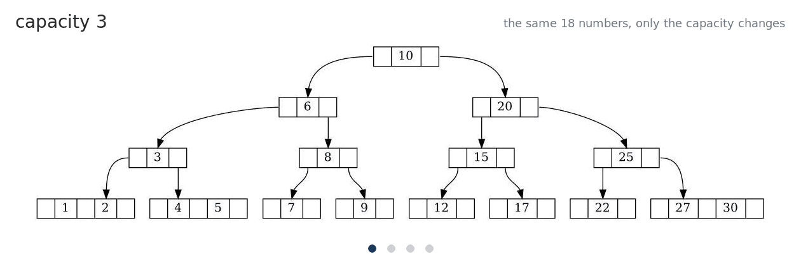
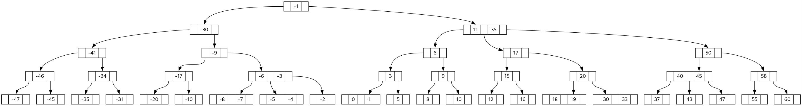
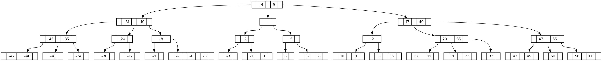
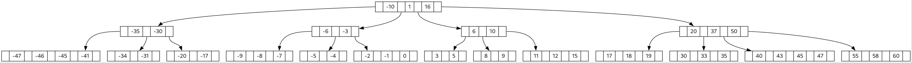
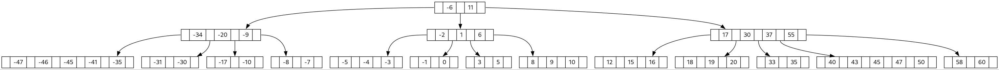
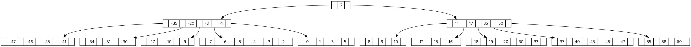
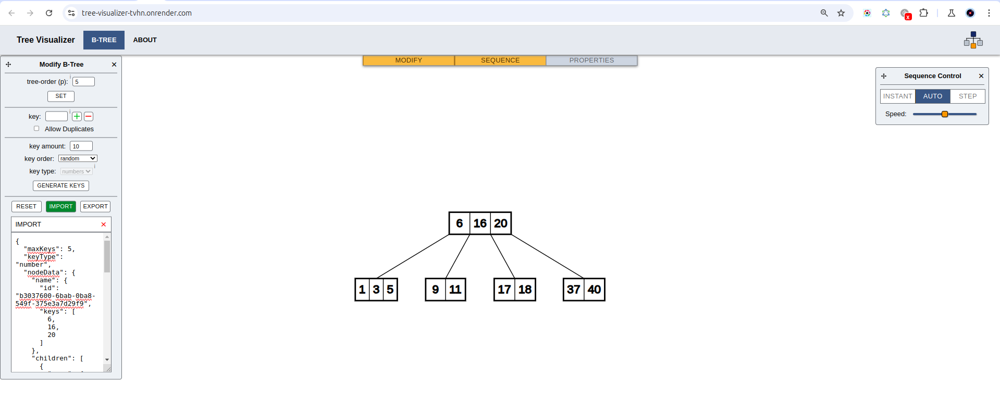

<p align="center">
  
</p>

<h1 align="center">PHP B-Tree</h1>

<p align="center">
  Build a balanced B-tree from your numbers and see it as a picture and a JSON dump.
</p>

<p align="center">
  <a href="https://www.php.net/"></a>
  <a href="#installation"></a>
  <a href="LICENSE"></a>
  <a href="#installation"></a>
</p>

<p align="center">
  
</p>

<p align="center">
  <sub>The same 18 numbers with capacity 3 to 6. The first picture was built with <code>make btree capacity=3 set="10, 20, 5, 6, 12, 30, 7, 17, 3, 1, 25, 15, 8, 2, 4, 22, 27, 9" graph=1</code></sub>
</p>

## Table of contents

- [Overview](#overview)
- [Installation](#installation)
    - [Linux](#linux)
    - [macOS](#macos)
    - [Windows](#windows)
- [Quick start](#quick-start)
- [Make commands](#make-commands)
- [Building a tree](#building-a-tree)
- [Results](#results)
    - [Pictures](#pictures)
    - [Dumps](#dumps)
- [Working inside the container](#working-inside-the-container)
- [Troubleshooting](#troubleshooting)
- [Code map](#code-map)
- [Helpful sources](#helpful-sources)
- [License](#license)

## Overview

PHP B-Tree is a small tool for learning how a balanced B-tree works.
You give it a set of numbers, and it builds a B-tree from them.
Then it can draw the tree as a picture and save its structure as a JSON dump.
You can open the dump in an online visualizer and compare the two pictures.

The project is ready to use, not a library.
The code is written in an object-oriented style, so you can read it step by step.
It is made for learners, students and PHP developers who want to see a B-tree in PHP.

Everything runs in Docker.
PHP, Composer and the tool that draws the pictures live inside the container,
so on your machine you need only **Docker**, **make** and **git**.

## Installation

You need three things on your machine.

- Docker with Docker Compose v2, that is the `docker compose` command
- make
- git, to get the project

Pick your system below. After that, go to [Quick start](#quick-start).

### Linux

1. Install Docker Engine for your distribution with the [official guide](https://docs.docker.com/engine/install/). It
   installs Docker Compose too. If you use Docker Desktop for Linux instead, read the note about `permission denied`
   in [Troubleshooting](#troubleshooting).
2. Let your user run Docker without `sudo` with
   the [post-installation steps](https://docs.docker.com/engine/install/linux-postinstall/). Keep in mind that the
   `docker` group gives root-level rights.
3. Install make and git. On Debian or Ubuntu run `sudo apt update && sudo apt install make git`.

### macOS

1. Install [Docker Desktop for Mac](https://docs.docker.com/desktop/setup/install/mac-install/) and start it. It
   includes Docker Compose.
2. Install make and git with the Xcode Command Line Tools. Run `xcode-select --install`.

### Windows

On Windows the project runs through WSL 2, a Linux system inside Windows. Docker Desktop uses WSL 2 too.

1. Install WSL 2 with Ubuntu with the [Microsoft guide](https://learn.microsoft.com/en-us/windows/wsl/install).
2. Install [Docker Desktop for Windows](https://docs.docker.com/desktop/setup/install/windows-install/) with the WSL 2
   backend and start it.
3. In Docker Desktop open **Settings > Resources > WSL Integration** and turn it on for Ubuntu.
4. Open the Ubuntu terminal and install make and git with `sudo apt update && sudo apt install make git`.
5. Clone the project inside your Ubuntu home folder, for example `~/projects`, not on the `C:` drive. Docker works with
   these files much faster.

Run all make commands in the Ubuntu terminal.

## Quick start

```bash
git clone https://github.com/sandftae/php-b-tree.git

cd php-b-tree

make btree capacity=4 set="1, 2, 3, 4, 5, 6, 7, 8, 9, 10" graph=1 dump=1
```

The first run takes a few minutes, because Docker downloads PHP and builds the image.
The next runs start in seconds.

Then open the newest picture in `<project-dir>/media/graph` and the newest dump in `<project-dir>/media/dump`.
On Windows you can open the folder from the Ubuntu terminal with `cd <project-dir>/media/graph && explorer.exe .`.

## Make commands

| Command       | What it does                                                                                                                                                 |
|---------------|--------------------------------------------------------------------------------------------------------------------------------------------------------------|
| `make help`   | Shows the list of commands. Plain `make` does the same.                                                                                                      |
| `make btree`  | Builds a B-tree. See [Building a tree](#building-a-tree).                                                                                                    |
| `make shell`  | Opens bash inside the PHP container. See [Working inside the container](#working-inside-the-container).                                                      |
| `make remove` | Removes the Docker containers, image, network and volumes of the project, and the base images if Docker keeps them as images. Your files and `vendor/` stay. |

## Building a tree

`make btree` takes the values below and builds the B-tree.

| Value            | Flag           | What it means                                                                                            | Default                  |
|------------------|----------------|----------------------------------------------------------------------------------------------------------|--------------------------|
| `capacity=5`     | `-c 5`         | The most children a node can have, so a node holds up to capacity minus 1 keys. Values below 3 become 3. | 3                        |
| `set="1, 2, 3"`  | `-s "1, 2, 3"` | The numbers for the tree, separated by commas and put in quotes. Repeated numbers are used once.         | numbers from -100 to 100 |
| `file=name.json` | `-f name.json` | A JSON file with numbers from `media/number-sets`. It wins over `set`.                                   | not used                 |
| `graph=1`        | `-g`           | Draws the tree as a picture in `media/graph`.                                                            | no picture               |
| `dump=1`         | `-d`           | Saves the tree as JSON in `media/dump`.                                                                  | no dump                  |

> [!NOTE]
> Without `graph=1` and `dump=1` the tree is still built, but nothing is saved.

Examples.

```bash
# A tree from your numbers, with a picture and a dump
make btree capacity=5 set="1, 2, 3, 4, 5, 6" graph=1 dump=1

# A tree from a file in media/number-sets, picture only
make btree file=num_set_exmpl.json graph=1

# A tree from the numbers -100 to 100 with capacity 3, picture only
make btree graph=1
```

A number set file is a JSON array with one set of numbers.
See `media/number-sets/num_set_exmpl.json` as an example.
Put your own files next to it and pass only the file name.

## Results

### Pictures

Each run with `graph=1` saves a new picture in `<project-dir>/media/graph`.
The name holds the date and time in UTC, for example `b_tree_graph_2026-11-24-16-33-28.jpeg`.

**Capacity 3**


**Capacity 4**


**Capacity 5**


**Capacity 6**


**Capacity 7**


### Dumps

Each run with `dump=1` saves a new JSON dump in `<project-dir>/media/dump`, named the same way, for example
`tree_dump_2026-11-24-16-33-28.json`.
This is a dump of a tree with capacity 5.

```json
{
  "maxKeys": 5,
  "keyType": "number",
  "nodeData": {
    "name": {
      "id": "b3037600-6bab-0ba8-549f-375e3a7d29f9",
      "keys": [
        6,
        16,
        20
      ]
    },
    "children": [
      {
        "name": {
          "id": "da561c35-88a9-697a-8492-587a422b89b0",
          "keys": [
            1,
            3,
            5
          ]
        }
      },
      {
        "name": {
          "id": "79121886-5ada-d62a-7cd9-6ad2606b6f14",
          "keys": [
            9,
            11
          ]
        }
      },
      {
        "name": {
          "id": "264f2d4a-9d2d-f620-c501-b244cc8334ea",
          "keys": [
            17,
            18
          ]
        }
      },
      {
        "name": {
          "id": "fbe3a3e4-8a34-067d-d751-f7fb162093da",
          "keys": [
            37,
            40
          ]
        }
      }
    ]
  }
}
```

**To see a dump as a tree**, import it into the [Tree Visualizer](https://tree-visualizer-tvhn.onrender.com/).

> [!IMPORTANT]
> Set **tree-order (p)** to the same value as the capacity of the dump.
> You find it on the **Modify** tab of the visualizer.

This is the visualizer picture of a dump with capacity 5.



More sample dumps are in `media/dump/examples`.

## Working inside the container

`make btree` covers the usual cases.
If you want to type the commands yourself, open a shell in the container with `make shell`.
Inside it you have PHP, Composer and `bin/console` with all its flags.

The full guide is in [docs/console.md](docs/console.md).

## Troubleshooting

**`make: command not found`**
Install make. On Debian or Ubuntu run `sudo apt update && sudo apt install make`. On macOS run `xcode-select --install`.
On Windows run the commands in the Ubuntu terminal of WSL 2 and install make there.

**`permission denied while trying to connect to the Docker daemon socket` on Linux**
Your user is not in the `docker` group yet.
Follow the [post-installation steps](https://docs.docker.com/engine/install/linux-postinstall/), then log out and log in
again.

**`permission denied` when composer installs packages or a picture is saved**
This happens with rootless Docker and with Docker Desktop for Linux.
There your own user is root inside the container, so the container must run as root to write your files.
Add `HOST_UID=0 HOST_GID=0` to the command, for example `make btree HOST_UID=0 HOST_GID=0 graph=1`.
To keep it for all commands, run `export HOST_UID=0 HOST_GID=0` in your terminal first.

**`Cannot connect to the Docker daemon` or `docker: command not found` on macOS or Windows**
Start Docker Desktop and wait until it is running.
On Windows also check that **Settings > Resources > WSL Integration** is on for Ubuntu.

**No picture or dump after `make btree`**
Add `graph=1` for a picture and `dump=1` for a dump.
Without them the tree is built, but nothing is saved.

**The prompt in `make shell` says `I have no name!`**
This is fine. The container runs as your user, so the files it makes belong to you.
Your user id simply has no name inside the container.

## Code map

Start reading from `app/code/Btree/Cli/BtreeProcessor.php`.
One short method there shows the whole path from the numbers to a balanced tree.

```text
bin/console                      the command that make btree runs in the container
app/container/di.xml             which class does what, folder names, default capacity
app/frame/                       a small framework that reads di.xml, creates objects and reads the flags
app/code/Btree/
  Cli/BtreeProcessor.php         builds the tree from the numbers, then saves the picture and the dump
  Model/TreeElement/             the tree, its nodes and its keys
  Model/NodeCrawler.php          walks down from the root to the node where a new key goes
  Model/Balance/                 puts a key into a node and splits a node that is full
  Model/KeyNodeLinker.php        links child nodes to the keys of their parent
  Model/SiblingPoint/            finds the key a child node belongs to
app/code/GraphicConsole/         draws the tree as a picture
app/code/Dump/                   saves the tree as a JSON dump
media/number-sets/               files with numbers for file=
media/graph/                     pictures, examples/ holds the samples from this page
media/dump/                      dumps, examples/ holds sample dumps
docker/php/                      the Dockerfile and php.ini of the PHP container
```

## Helpful sources

- [B-tree visualization at USFCA](https://www.cs.usfca.edu/~galles/visualization/BTree.html) lets you build a B-tree
  step by step.
- [B+Tree index structures in InnoDB](https://blog.jcole.us/2013/01/10/btree-index-structures-in-innodb/) explains how
  MySQL keeps its indexes in a B+tree.
- [Graphviz Online](https://dreampuf.github.io/GraphvizOnline/) is an online editor for DOT graphs.

## License

PHP B-Tree is released under the MIT License. See [LICENSE](LICENSE).
